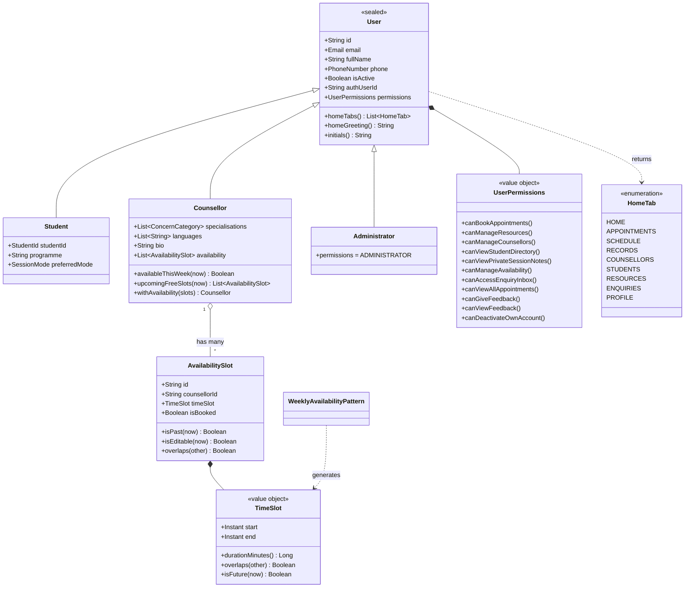
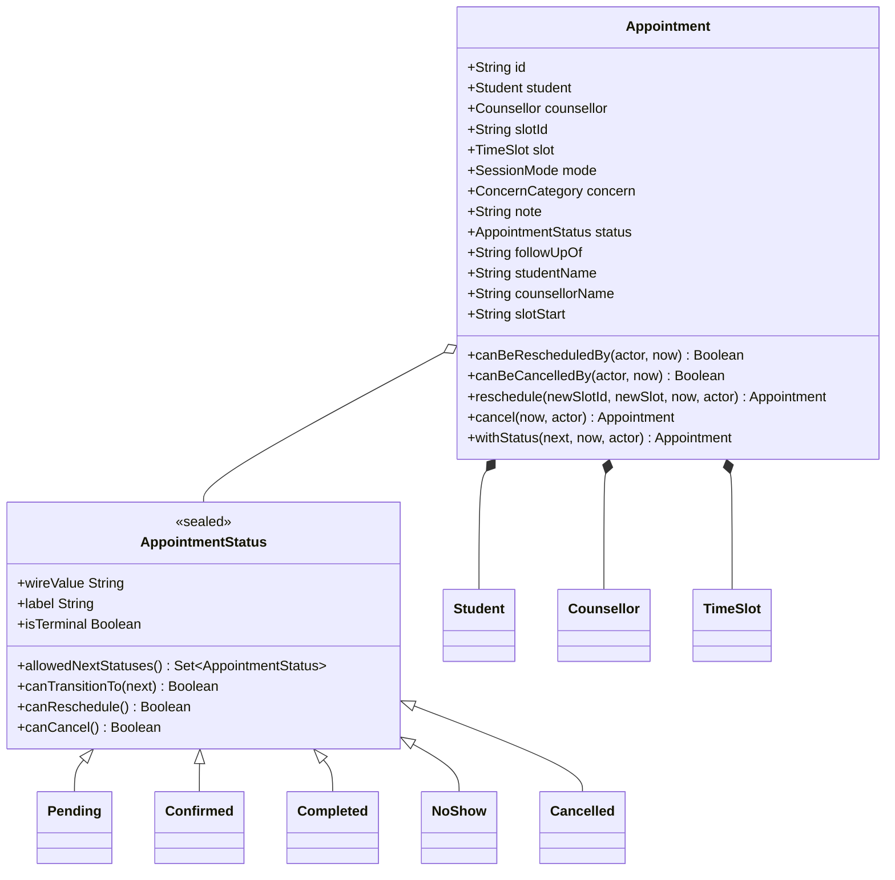
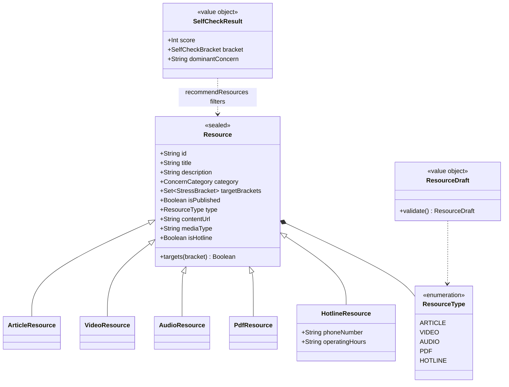
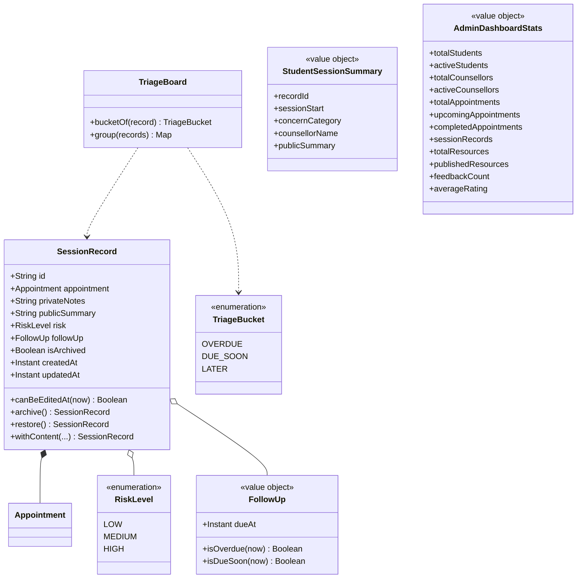
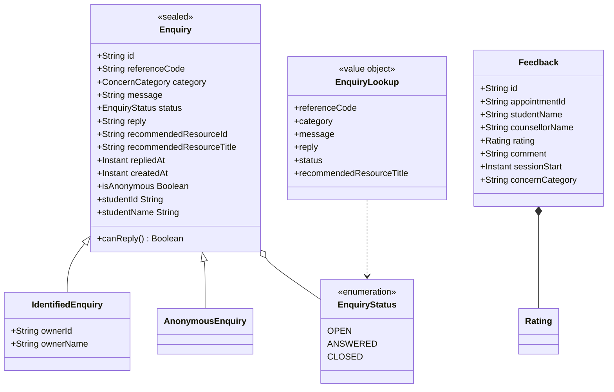
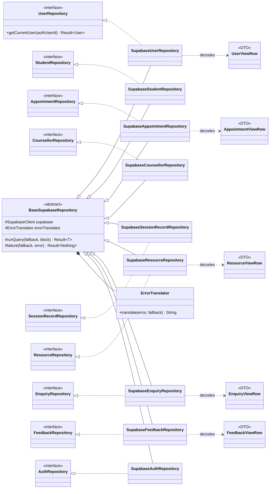

# OOP Class Diagram

**Project:** University Counselling Appointment & Support System (AMCS2194)  
**Scope:** final Android domain + persistence architecture after Phases 2–6.

The Android domain packages are pure Kotlin. Android/Compose lives in `ui`, and
Supabase DTOs/mappers live in `data`. This is intentional: the class diagram
below is the business model, not a diagram of Composable functions.

---

## 1. User hierarchy and counsellor availability



`Counsellor` is the polymorphic object that supplies directory data,
availability and dashboard tabs. UI code never checks a `role` string; it calls
`user.homeTabs()` and `user.permissions`.

---

## 2. Appointment and State pattern



The status transition table is owned by the State classes, not by UI string
comparisons. `Appointment` also owns the 12-hour student/counsellor reschedule
rules and cancellation-before-start rule.

---

## 3. Resources, self-check and recommendations



This mirrors the database's `resources` class-table inheritance with five
subtype tables. `v_resources` is mapped back to the correct Kotlin subtype.

---

## 4. Session records, Follow-up and Triage



`StudentSessionSummary` is a separate safe projection; students never receive
the private `SessionRecord` or its `Appointment` internals.

---

## 5. Enquiry hierarchy and feedback



Anonymous rows carry no student id/name in the domain, even if a future backend
projection accidentally includes an empty column.

---

## 6. Persistence architecture



The data class names above are illustrative of each repository's private DTO;
they are deliberately private so ViewModels cannot accidentally depend on
PostgREST row shapes.

---

## 7. UI dependency direction

```text
Composable Screen
      │ events / state
      ▼
ViewModel ──────────────► Repository INTERFACE
      │                         │
      │ StateFlow<UiState>      │ Result<Domain>
      ▼                         ▼
Compose UI              SupabaseRepository IMPLEMENTATION
                                │
                                │ DTO decode + mapper
                                ▼
                        PostgREST view / RPC
```

- Screens do not import `data` or `io.github.jan.supabase`.
- ViewModels import domain interfaces only (plus `SessionManager` for auth).
- `AppContainer` is the only composition root and is manual DI.
- Every repository returns `Result<T>` with `ErrorTranslator` messages.

---

## 8. Ownership map

| Package | Owner | Main classes |
|---|---|---|
| `core/domain` | shared | `User`, `Student`, `Counsellor`, `Administrator`, `ValueObjects`, `AppointmentStatus`, `AvailabilitySlot` |
| `core/data` | shared | `BaseSupabaseRepository`, `SupabaseUserRepository`, `ErrorTranslator`, `UserViewRow` |
| `core/ui` | shared | `BaseViewModel` |
| `feature/auth` | Beh | `AuthRepository`, `RegistrationDetails` |
| `feature/student` | Beh | `StudentRepository`, `SupabaseStudentRepository` |
| `feature/appointment` | Beh | `Appointment`, `AppointmentRepository`, `CounsellorMatchStrategy` |
| `feature/counsellor` | Jeremy | `CounsellorRepository`, `WeeklyAvailabilityPattern` |
| `feature/records` | Jeremy | `SessionRecord`, `FollowUp`, `TriageBoard`, `SessionRecordRepository` |
| `feature/resource` | Michael | `Resource` hierarchy, `ResourceDraft`, `SelfCheckContent`, `ResourceRepository` |
| `feature/enquiry` | Michael | `Enquiry` hierarchy, `Feedback`, `EnquiryRepository`, `FeedbackRepository` |

The class diagram is intentionally kept in one file so the assessor can compare
it with the ERD in [`ERD.mmd`](ERD.mmd).
